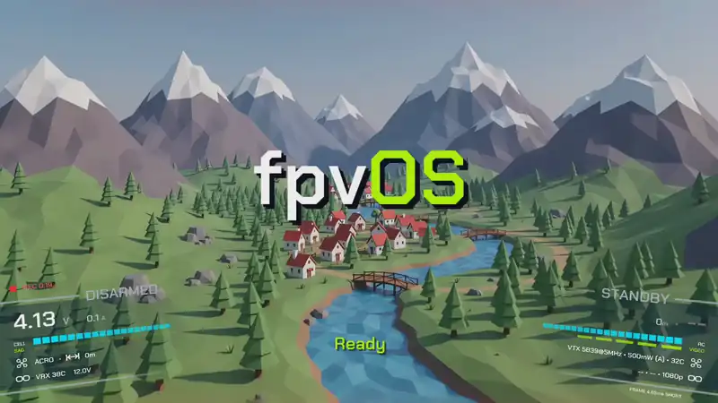
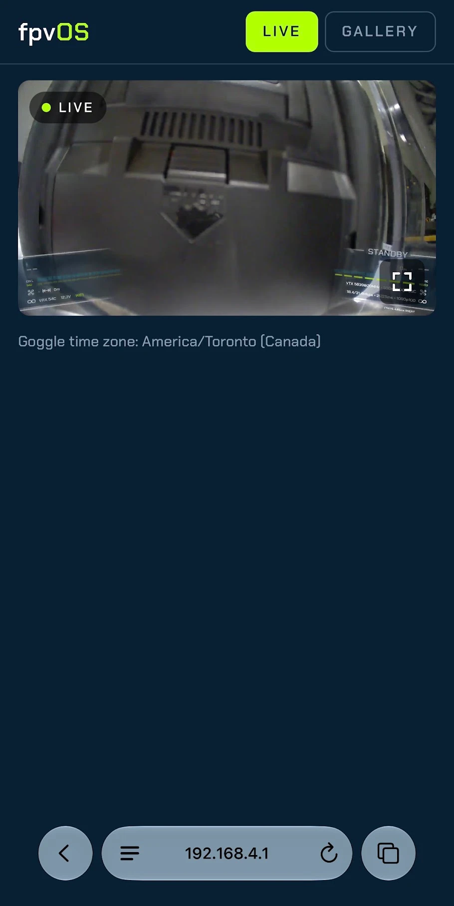
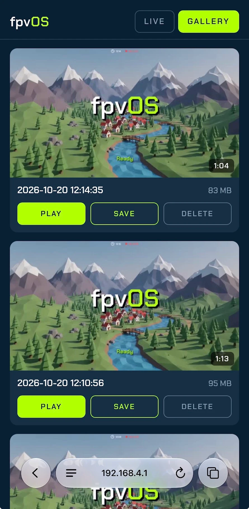
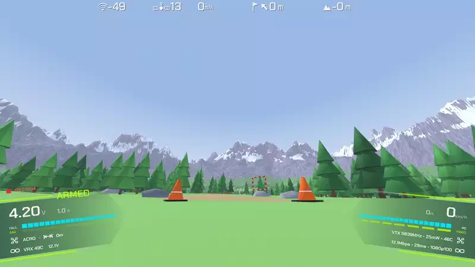
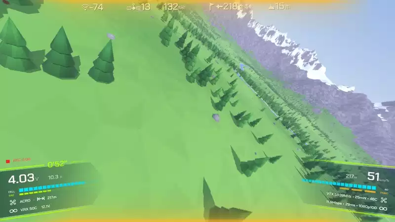
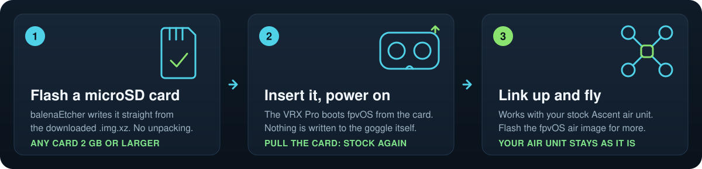

### Open firmware for the Caddx Ascent.

**Flash a microSD card, put it in your VRX Pro, fly. Pull the card and it's stock again.**

[Why fly it](#why-fly-it) · [Install](#install-in-three-steps) · [FAQ](docs/FAQ.md) · [Compatibility](#compatibility) · [Help and docs](#help-and-docs)

`GPLv3` · `status: beta, flies today`

 

 The idle screen, then the warp into the live picture as the aircraft links up.

---

fpvOS replaces the stock firmware on the **Caddx Ascent VRX Pro** with an open
one, drawn on the goggle's GPU. The fpvOS air image opens up the Ascent Lite and
Lite+ too, and the radio between them runs an open firmware on both ends,
[Open8030](https://github.com/gehee/Open8030).

## Why fly it

- **Low latency, and it stays there.** **25 ms** median glass to glass with
  screen tearing, **27.5 ms** without: an Ascent Lite+ with the fpvOS air image
  at 864p120, and a VRX Pro driving a 120 Hz screen. Measured with an LED in
  front of the camera and a photodiode on the screen
  ([details](docs/LATENCY.md)). No keyframe spikes, and each
  picture is decoded as its slices arrive.
- **A HUD that flies with you.** A GPU scene that banks with the aircraft, from
  the camera's IMU or the flight controller's gyro, over your Betaflight OSD.
- **Yours.** Five themes, settings for camera, video, radio and display, and
  every pixel on screen is code you can read and change.

 Arming and flying with the reactive HUD, in a simulated flight.

 

<table>
<tr>
<td width="40%"><b>Let your friends watch.</b>  Phones join the VRX's WiFi and open <code>192.168.4.1</code>: your live view, HUD and all, and your recordings. No app.</td>
<td align="center">&nbsp;&nbsp;</td>
</tr>
<tr>
<td width="40%"><b>Record and play back on the goggle.</b>  <b>FPV</b> keeps the camera's stream, <b>SCREEN</b> records video and HUD together at up to 100 fps, and the gallery plays, seeks and deletes without a computer.</td>
<td align="center"></td>
</tr>
<tr>
<td width="40%"><b>See what the link is doing.</b>  Latency per stage, frame pacing, the link and temperatures, live.</td>
<td align="center"></td>
</tr>
</table>

The goal is zero regressions: anything stock does, fpvOS should do. The full
tour is in the [user guide](docs/GUIDE.md); questions in the [FAQ](docs/FAQ.md).

## Install in three steps

1. **Write** [`fpvOS-vrxpro-<version>.img.xz`](https://github.com/gehee/fpvOS/releases/latest)
   from the latest release to a microSD card (2 GB or more) with
   [balenaEtcher](https://etcher.balena.io/), as it is: no unpacking.
2. **Put the card in the goggle and power it on.** The fpvOS idle screen means
   you're on fpvOS.
3. **Fly.** A stock Ascent air unit links right away, and stays bound.

Nothing is written to the goggle itself: **pull the card and it boots exactly
as before.** Step by step: **[docs/INSTALL.md](docs/INSTALL.md)**.

**Optional, the air unit:** the fpvOS air image (Lite and Lite+) makes the
latency steady and adds end-to-end measurements, the reactive HUD and flight
controller telemetry. Flash it from Chrome or Edge with the
**[fpvOS Flasher](https://gehee.github.io/fpvOS_flasher/)**; Caddx's own
update takes it back. Read [the air unit guide](docs/INSTALL.md#flash-the-air-unit-optional)
first: it's the one step that writes to your hardware.

## Compatibility

| Device | Stock firmware | fpvOS |
|---|---|---|
| **Caddx Ascent VRX Pro** (goggle) | — | ✅ boots from the SD card |
| **Caddx Ascent Lite** (air, CV2004, IMU) | ✅ links to fpvOS | ✅ fpvOS air image |
| **Caddx Ascent Lite+** (air, OS02K10) | ✅ links to fpvOS | ✅ fpvOS air image |

[What the fpvOS air image adds](docs/FAQ.md#what-the-fpvos-air-image-adds) over a stock air unit.

## Before you fly

fpvOS is **beta** software, and it runs the video link you fly by.

- **Keep a stock card handy.** Swapping cards is your fallback.
- **A freeze or a dropout mid-flight can cost you the aircraft, or worse.**
  Bench-test it, then fly line-of-sight or over open ground until you trust it.
- **RF compliance is your responsibility.** Check your country's rules for 5 GHz
  video transmitters.
- **The WiFi access point is 2.4 GHz,** off at every boot. Switched on, it sits
  next to a 2.4 GHz RC link: plug in an external antenna and range-test first.
- **No warranty.** Provided as is, at your own risk: sections 15 and 16 of the
  [GPLv3](LICENSE).

## Help and docs

| | |
|---|---|
| [Install](docs/INSTALL.md) · [User guide](docs/GUIDE.md) · [FAQ](docs/FAQ.md) · [Troubleshooting](docs/TROUBLESHOOTING.md) | flying it, and the known issues |
| [Discord](https://discord.gg/kWZA5WcMZ) · [Report a bug](https://github.com/gehee/fpvOS/issues/new/choose) · [Releases](https://github.com/gehee/fpvOS/releases) | questions, bugs, what changed ([SUPPORT.md](SUPPORT.md)) |
| [About](docs/ABOUT.md) · [Building](docs/BUILD.md) · [Architecture](docs/ARCHITECTURE.md) · [Kernel](docs/KERNEL.md) · [Contributing](CONTRIBUTING.md) | how it's made, and changing it |

Built on Artosyn's AR8030 and Caddx's Ascent, with thanks. [GPLv3](LICENSE), details in [About](docs/ABOUT.md#license).

**fpvOS**: the goggle is open now.

